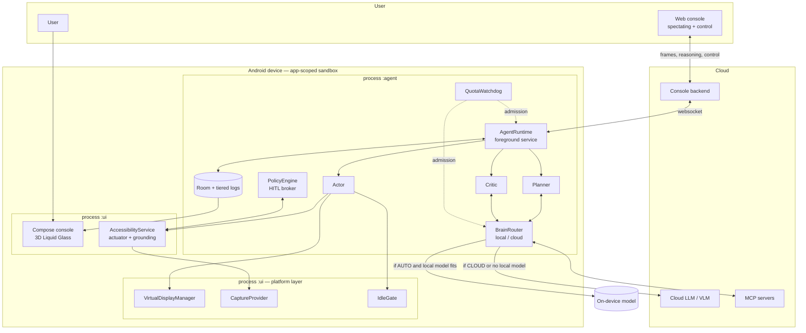
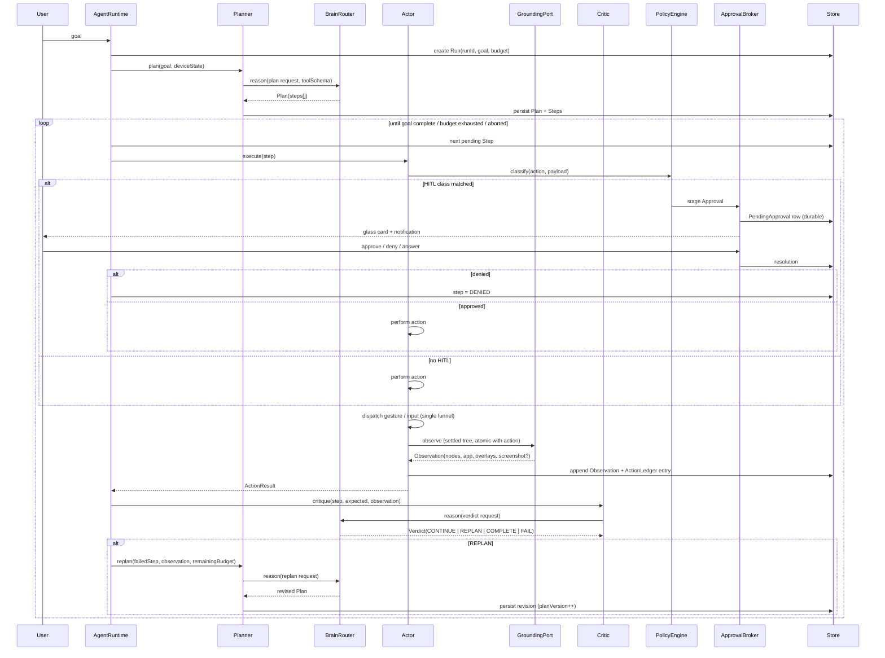
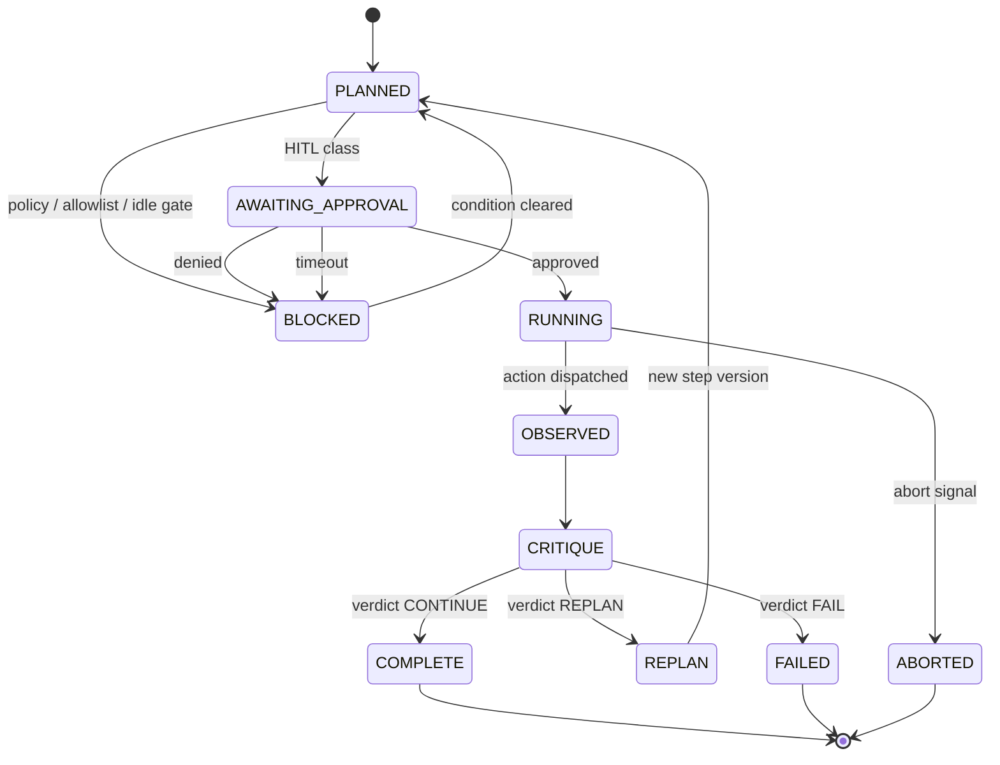
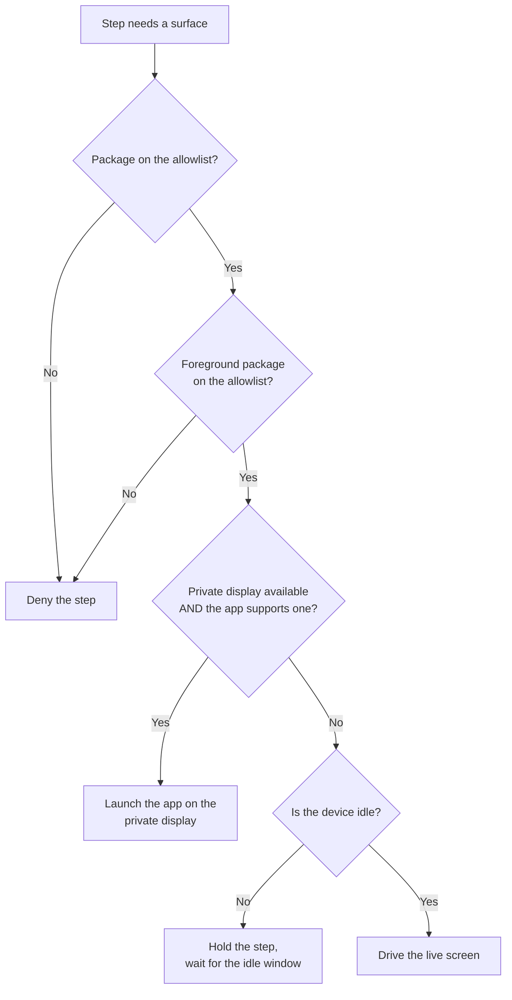
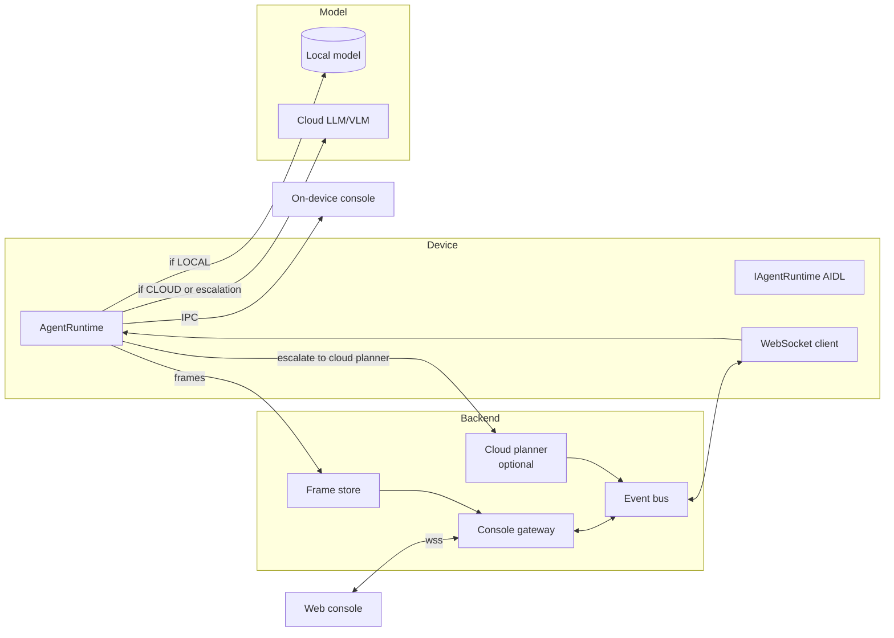
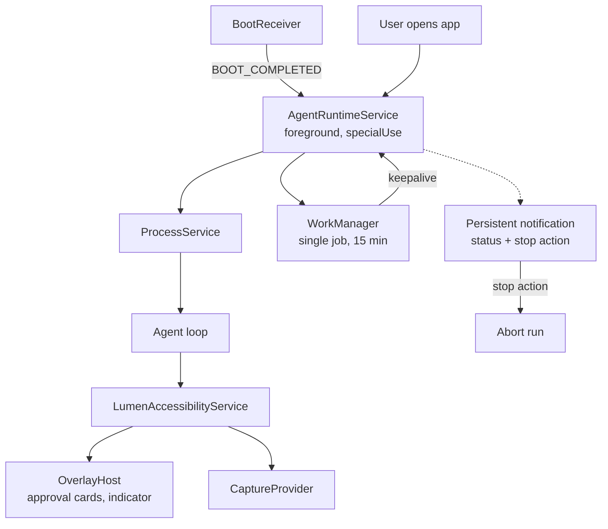
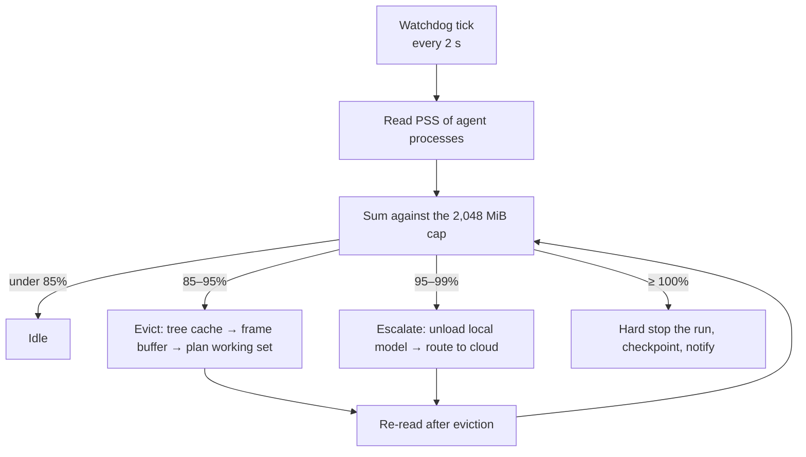
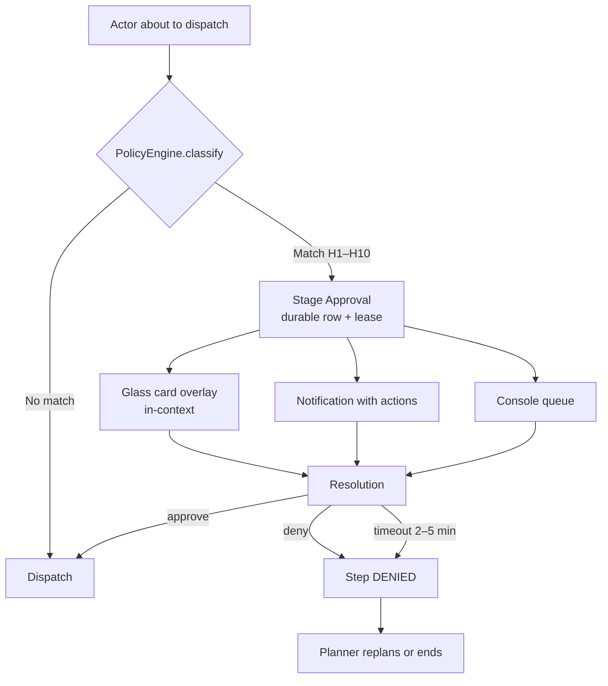
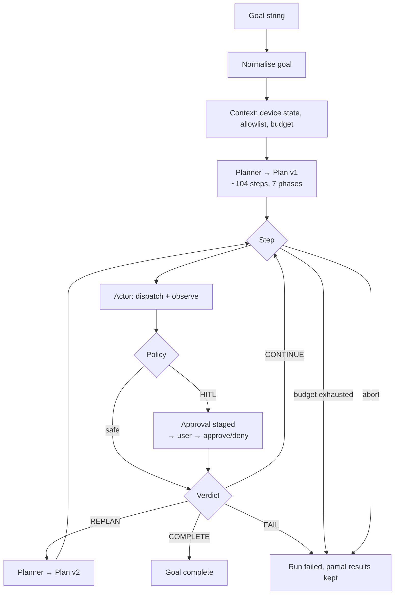

# ARCH.md — LUMEN Architecture

**Status:** Draft for review · **Spec version:** 1.0 · **Codename:** LUMEN (placeholder)

Companion documents: `AGENTS.md` (binding contract), `PRD.md` (requirements), `TECHSTACK.md` (locked versions), `API_SPEC.md` (contracts), `STYLE_GUIDE.md` (visual system), `CODING_STANDARDS.md` (code rules), `TESTING.md` (test specs), `TASK.md` (milestones), `RE_ANALYSIS.md` (frozen reference analysis).

---

## 1. System context



**Process split and why.** The console (`:ui`) can be killed and relaunched by the user at any time without interrupting a run, so the run state lives in the agent process and is mirrored to the console over a Binder. The `AccessibilityService` is hosted in `:ui` because Android requires it to be in a process the user can enable; the agent process talks to it over a Binder service, never by direct call.

---

## 2. Module map

```
core/            pure Kotlin/JVM — no android.* imports
  model/         Goal, Plan, Step, StepState, Observation, Decision, Reason
  agent/         AgentRuntime, Planner, Actor, Critic, RunController
  brain/         BrainPort, BrainRouter, LocalBrain, CloudBrain, ToolSchema
  policy/        PolicyEngine, DangerClassifier, ApprovalBroker
  quota/         QuotaWatchdog, RamBudget, StorageBudget, ThermalGovernor
  sandbox/       SandboxPath, WorkspaceManager, PathValidator
  store/         RunDao, StepDao, ApprovalDao, TraceWriter, FrameStore
  protocol/      McpClient, ToolCall, ToolResult
  grounding/     GroundingPort, TreeSnapshot, NodeIndex, SettleDetector (pure model)
  action/        Action sealed class, ActionPlan, ActionResult

platform/        Android-only
  accessibility/ LumenAccessibilityService, NodeReader, GestureInjector
  capture/       CaptureProvider (canTakeScreenshot + MediaProjection)
  virtualdisplay/ VirtualDisplayManager
  idle/          IdleGate, TouchObserver, ScreenStateMonitor
  overlay/       OverlayHost, ApprovalCardHost, IndicatorHost

agent/           Android app module — process :agent
  service/       AgentRuntimeService (foreground), BootReceiver, WorkerFanout
  ipc/           IAgentRuntime.aidl, StateStream, FrameStream

app/             Android app module — process :ui
  ui/            Compose console, glass surfaces, indicator layers
  web/           console-web (separate build, static SPA)
```

**Boundary rule (enforced by `:core:dependencyGuard`):** `core/*` may not reference `android.*`, `platform/*`, or `agent/*`. `platform/*` may not reference `agent/*`. `app/*` may not reference `agent/*` internals — it goes through AIDL.

**One named exception (ADR 0002):** `:core:store` is an Android library, because Room is an Android-only artifact. The persistence *port* (`StateStore`) and every DTO live in `:core:model`, which stays pure, so `:core:agent` — the loop — remains a plain JVM module with a fake store, and `:core:agent:test` needs no Robolectric. `:core:store` may depend on `androidx.room`, `androidx.datastore` and `androidx.sqlite` and nothing else outside `core/`.

**Test fixtures.** A module that owns a fake publishes it through the Gradle `java-test-fixtures` plugin, in `src/testFixtures/kotlin`. A module that needs one declares `testImplementation(testFixtures(project(":core:action")))`. There is no shared test module, the fakes never reach a shipped classpath, and a fake lives next to the code it stands in for. `SyntheticTreeBuilder` (`:core:grounding`) and `FakeActionExecutor` (`:core:action`) are the first two.

---

## 3. The Planner–Actor–Critic loop



### 3.1 Loop invariants

| Invariant | Enforcement |
|---|---|
| Exactly one action is in flight | The actor is single-threaded; the loop awaits `ActionResult` before the next step |
| An observation always follows a mutating action | `Actor` composes them; there is no "act without observe" path |
| A step cannot begin without a persisted `Reason` | `Step.reason` is non-null in the schema |
| No step dispatches without a ledger pre-state | The loop reaches the device only through `LedgeredActionExecutor`, which calls `ActionLedger.record` before the delegate. `FileLedgerSink` forces the line to the device, and an entry that did not become durable denies the action |
| A step that has run is never picked again | The plan is updated **in memory** as well as in the store, and `nextStep` reads the in-memory plan. A step that ran and was not marked would be picked again, and the run would never advance |
| The loop can be aborted at any boundary | `AbortSignal` is checked before dispatch and between steps |
| The loop never blocks on HITL | `ApprovalBroker` returns immediately with a pending id; the step waits on a flow owned by the run |

### 3.2 Step lifecycle



---

## 4. Grounding and action dispatch

### 4.1 The single dispatch funnel

Every mutating operation in the system passes through one place:

```kotlin
interface ActionExecutor {
    suspend fun dispatch(action: Action): ActionResult
}
```

`Action` is a sealed type in `core/action`:

| Action | Params | Mutating |
|---|---|---|
| `Tap` | relative x,y | ✅ |
| `DoubleTap` | relative x,y | ✅ |
| `LongPress` | relative x,y, duration | ✅ |
| `Swipe` | relative from/to, duration, path | ✅ |
| `Scroll` | direction, amount, lane | ✅ |
| `Drag` | path points, duration, easing | ✅ |
| `InputText` | text | ✅ |
| `PasteText` | text | ✅ |
| `PressEnter` | — | ✅ |
| `ClickById` | viewId | ✅ |
| `ClickText` | text, occurrence | ✅ |
| `OpenApp` | package | ✅ |
| `OpenUrl` | url | ✅ |
| `ListApps` | — | ❌ |
| `ObserveScreen` | includeScreenshot, includeOverlays | ❌ |
| `Screenshot` | region | ❌ |
| `ReadFile` | sandbox path | ❌ |

**Relative coordinates.** All coordinates are normalised `0.0..1.0` against the *root window* bounds and resolved to pixels on-device at dispatch. The planner never needs the device resolution, and a plan survives a display change.

**Atomic action + observation.** Mutating actions return the post-action screen state. `Actor` calls `SettleDetector` and then `GroundingPort.observe()` in the same step, so the result of a step always contains what the screen looked like *after* the action settled. There is no separate "now look" action in the planner's vocabulary.

### 4.2 Settle detection

```kotlin
interface SettleDetector {
    suspend fun awaitSettled(startedAt: Long, kind: SettleKind, capMs: Long): SettleResult
}

enum class SettleKind { SCROLL, NON_SCROLL, TYPING }
```

The detector is driven by an event clock maintained by the accessibility layer, not by sleeps:

| Signal | Value | Meaning |
|---|---|---|
| Quiet window | 160 ms | No UI event since the last change |
| No-change window | 90 ms | No UI event at all |
| Node-count stability | Δ ≤ 2 | Successive trees are the same size |
| Sample interval | 250 ms | Minimum spacing between stability samples |
| Observation window | 400 ms | Minimum time before a stability sample is trusted |
| Poll interval | 25 ms | Detector tick |
| Cap (scroll) | 1,500 ms | Hard ceiling |
| Cap (non-scroll) | 2,000 ms | Hard ceiling |
| Stale-tree guard | 150 ms | Re-read instead of returning a cached tree |

The detector is **pure** in `core/grounding` — it consumes an abstract `UiEventClock`, so it is unit-testable on the JVM with a synthetic clock.

**Two clocks, and the reason they are separate.** The *no-change* window is measured from the start of the wait: an event that never arrives is itself the signal that nothing happened. The *quiet* window is measured from the last event: a screen that keeps emitting events has not settled, however long the wait has been. The *tree-shape* window is also measured from the start of the wait, which is what makes it reachable: a screen that keeps emitting events but keeps the same shape is stable, and the detector recognises that instead of waiting for the cap.

### 4.3 Ground truth precedence

1. **Accessibility tree** — primary. Cheap, structured, always available.
2. **Screenshot + VLM** — fallback, only when the tree is empty, ambiguous, or the critic reports a grounding failure. Billed against the VLM budget and toggled by the user.
3. **Neither** — the step fails with `grounding_unavailable`; the critic decides whether to replan.

### 4.4 Idle gate, virtual display, and the surface policy

The agent acts on one of two surfaces: a **private virtual display** the user
cannot see, or the **live screen**. Which one is a decision, and the
decision has a fixed order:



**The order is the point.** The allowlist is checked first, because no
amount of idleness makes an app the user has not allowed fair game. The
private display comes next, because a surface the user cannot see never
interrupts them. The idle gate is last, because the live screen is the
last resort and it needs the user to be away.

**The idle gate** permits a live-surface action when the screen is off, or
the keyguard is locked, or nothing has touched the device for the idle
window (default 60 s). Any touch resets the window. A device that has never
been touched counts as idle.

**The virtual display** is opportunistic, and honestly so. Most apps can
render on a secondary display; some refuse, either because they are
single-display or because they check. The manager reports what it *can* do
rather than assuming, and a refusal falls back to the live surface when the
idle gate allows it. This is a platform limitation, not a design choice,
and it is why `D1` says "opportunistically".

**The foreground package is re-checked immediately before every
live-surface gesture.** A screen that changed under the agent is a screen the
agent did not agree to act on.

- `IdleGate` is satisfied when the screen is off, **or** the screen is on and no touch has been observed for the idle window (default 60 s).
- Any touch event resets the timer; the agent pauses at the next boundary (≤ 1 s).
- `VirtualDisplayManager` creates a private display, moves the target activity onto it with `ActivityManager.moveTaskToDisplay`, and reports success/failure. Failure is not fatal — the step falls back to the live surface **if** the idle gate allows it.
- The allowlist is checked before *both* paths. A package not on the allowlist is never dispatched to, on any surface.

---

## 5. Communication architecture



**Two independent transport families, deliberately separated:**

| Family | Path | Carries | Must not be blocked by |
|---|---|---|---|
| **Control** | HTTPS request/response + AIDL Binder (on-device) | Goals, plans, step events, approvals, budgets | Bulk media |
| **Bulk** | WebSocket frames + separate HTTP client for uploads | Screen frames, large artifacts | Control latency |

A 4 MB frame upload must never head-of-line-block a step approval.

**Cancellable in-flight transport.** Every outbound HTTP call is owned by the run scope and is cancelled on abort, so a shutdown never waits on a network timeout.

**Egress guard.** `ContentEgressGuard` sits in front of every outbound channel. It inspects the payload class (`Frame`, `Observation`, `AppMetadata`, `Text`) and denies anything screen-derived unless spectating is enabled for that content class. It is a deny-by-default allowlist of (content class → permitted when spectating on).

---

## 6. Android service lifecycle



**Service rules:**

- `AgentRuntimeService` is a foreground service with `foregroundServiceType="specialUse"`, and it declares the `FOREGROUND_SERVICE_SPECIAL_USE` subtype in the manifest. It runs in `:agent` so it survives the console being swiped away.
- The service is started when the user starts a goal, and stopped when the run ends, is aborted, or the quota watchdog force-stops it. It is **not** started at boot for a run that was not active at boot time; `BootReceiver` only re-arms a *resumable* run whose goal was still pending, and only after the user has granted the service in Settings.
- The foreground notification is mandatory while the service runs and carries a "Stop agent" action. It is not the visual indicator (see `PRD.md` §7) and is not suppressible.
- `WorkManager` runs one `keepalive` job to restart the service if the process is killed. It is not used for the agent loop itself.
- The `AccessibilityService` in `:ui` is enabled by the user in Settings and reports its state to `:agent` over AIDL. If it is revoked mid-run, the run pauses with `accessibility_revoked` and the console shows how to re-enable it.
- The `MediaProjection` capture service is started only on explicit user consent via `RequestCastActivity`; the accessibility `canTakeScreenshot` path is preferred and needs no consent.

---

## 7. The quota engine

### 7.1 RAM



**Admission control, not monitoring.** `QuotaWatchdog.reserve(bytes, category)` is called *before* an allocation that is not already accounted for. A local model load of 1,100 MiB is refused outright when the remaining budget is 900 MiB — the router escalates to cloud instead. There is no "load it and see".

**Accounting model.** Each consumer holds a reservation:

| Category | Cap | Reserve point |
|---|---|---|
| `BRAIN_MODEL` | 1,400 MiB | Before model load |
| `TREE_CACHE` | 192 MiB | Before caching a tree snapshot |
| `FRAME_BUFFER` | 128 MiB | Before allocating a frame buffer |
| `PLANNER_MEMORY` | 96 MiB | Before growing the plan working set |
| `BASELINE` | 64 MiB | Fixed |

**Eviction order** (first to go): frame buffers → tree cache (LRU) → planner working set (compacted to disk) → local model (unload, escalate).

### 7.2 Storage

Every byte the agent writes goes through `SandboxPath`, which:

1. Resolves the path against the sandbox root.
2. Rejects any path that escapes the root after canonicalisation (`..`, symlink escape, absolute path, `/proc`, `/data`).
3. Accounts the write against the bucket budget for the target area.
4. Refuses the write if the bucket is over budget, triggering eviction instead.

Buckets and caps are in `AGENTS.md` §2. `workspace/` is never auto-deleted; `frames/` and `traces/` are LRU-evicted with a documented order.

### 7.3 CPU, thermal, battery

| Signal | Source | Response |
|---|---|---|
| Temperature | `PowerManager.getCurrentThermalStatus()` | ≥ 42 °C → 1 worker; ≥ 46 °C → suspend local inference, cloud only |
| Battery | `BatteryManager` | < 20 % and not charging → suspend autonomous runs |
| CPU | `Process.setThreadPriority` + nice level | Never `SCHED_FIFO`; the agent is always nice'd |
| Backpressure | Queue depth in the worker pool | Depth > 32 → planner produces smaller batches |

---

## 8. HITL architecture



**Policy classification is deterministic and runs on-device.** It combines:

- The action type (payment, publish, delete, credential, permission, communication, account, legal).
- The target app's package.
- The screen context: the label of the node under the tap, the payment surface detected in the current tree, the presence of a publish/send affordance.
- A per-run, per-action-class grant list (never a global "auto-approve" toggle).

**A brain-model opinion can only make the policy stricter, never looser.** If the planner believes an action is safe, the classifier still runs. If the planner believes an action is dangerous but the classifier sees no match, the planner's classification is escalated to an ask — never the reverse.

**Staging, not blocking.** `ApprovalBroker.stage()` writes a `PendingApproval` row with a lease and returns. The step's coroutine suspends on a `StateFlow` owned by the run scope. The agent process can be killed while a step is pending; on restart the pending approvals are reloaded and re-surfaced.

---

## 9. Determinism

| Source of nondeterminism | Control |
|---|---|
| Model sampling | Seeded RNG; temperature pinned per call site; the seed is stored with the step |
| Planner prompt drift | Prompt version pinned in the plan record; a version change forces a re-plan, not a silent drift |
| Time | Timestamps are recorded but excluded from plan-equality comparison |
| Node ordering | The tree snapshot is canonically sorted before it reaches the planner |
| Concurrency | Single actor thread; the critic runs after the actor completes |
| Network | Cloud calls are pinned to a provider/model version; the response is cached per (prompt, model, seed) within a run |

`PlanEquivalence.assertEquivalent(planA, planB)` is a test utility used by the determinism suite.

---

## 10. Failure and recovery matrix

| Failure | Detection | Response | Run outcome |
|---|---|---|---|
| Accessibility service revoked | Service callback | Pause, explain, show re-enable instructions | Paused, resumable |
| Local model OOM or crash | Brain adapter | Unload, re-route to cloud, log | Continues |
| Cloud brain unreachable | HTTP timeout | Backoff + retry ×3, then fall back to local if available, else pause | Paused |
| Target app crashes mid-step | Process death observer | Step fails, critic replans | Continues |
| Screen never settles | Settle cap exceeded | Step returns `unsettled`, critic decides | Replan or fail |
| Ground tree empty | Grounding result | VLM fallback if enabled, else fail step | Replan |
| Storage full | SandboxPath reject | Evict LRU, retry, else fail step | Replan or fail |
| RAM over cap | Watchdog | Evict, escalate, hard-stop at 100 % | Checkpointed |
| Device locked | Idle gate | Wait for unlock, or use virtual display | Suspended |
| User touches the screen | Touch observer | Pause at the next boundary | Paused |
| Approval times out | Lease expiry | Deny | Step denied |
| Process killed | Boot/relaunch | Resume from the last persisted step | Resumes |
| Thermal limit | Thermal status | Drop workers, then suspend local inference | Slowed, then continues |

---

## 11. The 100-step run, end to end



**Plan representation.** A `Plan` is a versioned DAG of `Step`s. Each `Step` carries: an intent, a precondition (assertable against an observation), an action, an expectation (assertable against the observation), a risk class, a `Reason`, and a dependency edge set. The critic evaluates the expectation against the observation, which is what makes replanning possible rather than merely retrying.

**Checkpointing.** Every step transition is a transaction: the observation, the ledger entry, the updated step state, and the incremented plan version are written in one Room transaction. A run resumes from the last committed transition.

---

## 12. Adoption of reference patterns

`RE_ANALYSIS.md` §6 lists twelve patterns we adopt. Where each one lands in this architecture:

| # | Reference pattern | Our implementation |
|---|---|---|
| 1 | Single dispatch funnel | `ActionExecutor.dispatch` (§4.1) |
| 2 | Atomic action + observation | `Actor` composes dispatch + observe (§4.1) |
| 3 | Event-driven settle detection | `SettleDetector` (§4.2) |
| 4 | Relative coordinates | `Action` coordinate normalisation (§4.1) |
| 5 | Split control / bulk transport | Two transport families (§5) |
| 6 | Dual HITL surfaces | Overlay card + notification (§8) |
| 7 | Non-blocking approval staging | `ApprovalBroker.stage` (§8) |
| 8 | Device-state reporting | Context in the planner request (§5) |
| 9 | Package allowlist | `PolicyEngine` + allowlist (§4.4) |
| 10 | Cancellable in-flight transport | Run-scoped HTTP clients (§5) |
| 11 | runId-idempotent indicator | `IndicatorHost` (§`STYLE_GUIDE.md`) |
| 12 | Accessibility `canTakeScreenshot` | `CaptureProvider` (§6) |

Each is re-implemented in our own vocabulary. No reference source, asset, string, or icon is reused — see `AGENTS.md` §5.
